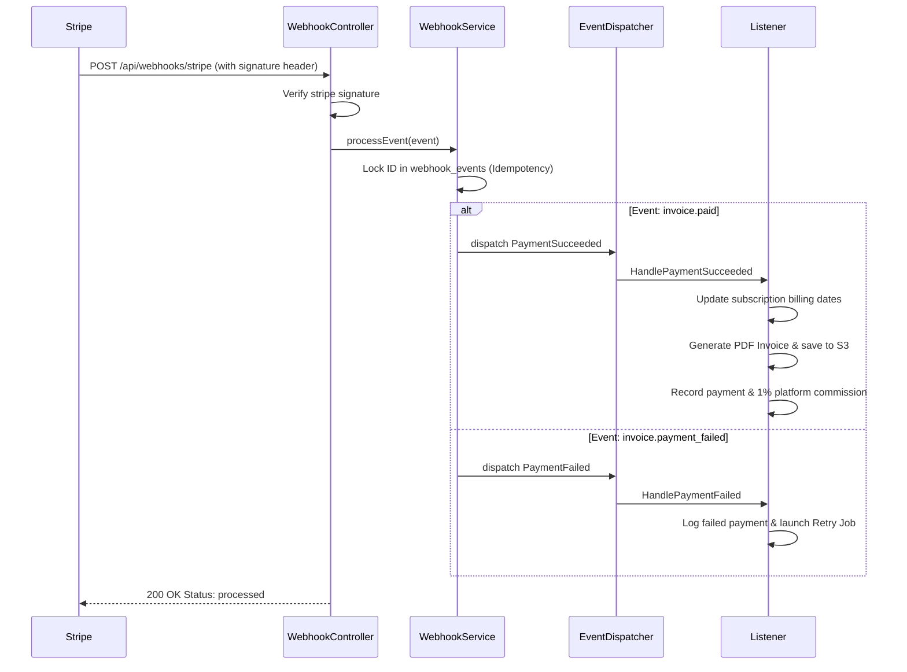

# SubGuard Platform - AI Agent Guide & System Memory

This document serves as the onboarding guide, technical architecture walkthrough, and system memory for AI agents working on the SubGuard Platform. It details what has already been built, how the system components interact, and guidelines for future modifications.

---

## 1. Project Overview & Business Value
SubGuard is an event-driven, cloud-native B2B SaaS platform that manages subscriptions, invoices, and analytics on top of Stripe. It is designed to scale to **100,000+ active subscriptions** with **latency under 300ms**.

### Key Features Implemented:
*   **Tenant & Customer Isolation**: Business Owners (Users) manage their own Customers and Plans. IDOR is prevented via strict Laravel middleware and query scope checks.
*   **Idempotent Stripe Billing**: Syncs state with Stripe via webhooks, logging processed events to guarantee no double-charging or duplicate metric registration.
*   **Automatic Dunning (Retry System)**: Background queue retries failed invoice payments over 72 hours before automatically canceling a subscription to mitigate involuntary churn.
*   **Commission Tracking**: Calculates and logs a 1% platform commission on all successful payments.
*   **Real-time Analytics**: High-performance aggregate calculations for MRR, LTV, Churn Rate, and growth metrics utilizing Redis caching (5-minute TTL).
*   **Modern Glassmorphism UI**: A premium Next.js dashboard featuring responsive layout, charts, billing logs, client listing, plan management, and CSV client uploads.

---

## 2. Technical Stack
*   **Backend**: Laravel 12 (PHP 8.3)
*   **Database**: PostgreSQL 16+ (Strict foreign keys, constraints, and indexes)
*   **Cache & Queue**: Redis 7+ (Handling queue workers and analytics cache)
*   **Authentication**: JSON Web Tokens (JWT) using `tymon/jwt-auth`
*   **Frontend**: Next.js 15 (App Router), React 19, TypeScript, TailwindCSS
*   **Containerization**: Fully Dockerized environments (services for Nginx, App, DB, Redis, Queue Worker, and Scheduler)

---

## 3. Directory Structure
```
subguard-platform/
├── app/                      # Backend Core Laravel Logic
│   ├── Console/              # Artisan commands & Scheduler
│   ├── Events/               # Event-Driven Architecture Events
│   ├── Http/
│   │   ├── Controllers/Api/  # Protected & Public REST Controllers
│   │   └── Middleware/       # JWT Auth, Rate Limiting, CORS
│   ├── Jobs/                 # Background Queue Workers (retries, emails)
│   ├── Listeners/            # Event Listeners (webhook execution results)
│   ├── Models/               # Eloquent Models (Database schemas mapped)
│   └── Services/             # Core Business Domain Logic (Stripe, Analytics, etc.)
├── config/                   # Configuration files (jwt, services, database)
├── database/
│   ├── migrations/           # PostgreSQL Migrations
│   └── seeders/              # Seeders for development
├── docs/                     # Documentation files
│   ├── API.md                # Endpoint Specifications
│   ├── DEPLOYMENT.md         # Production deployment instructions
│   └── AI_AGENT_GUIDE.md     # This document (AI Agent Onboarding Guide)
├── frontend/                 # Next.js Frontend Application
│   ├── app/                  # App Router structure
│   │   ├── dashboard/        # Dashboard layout, charts, and modules
│   │   ├── login/            # Auth pages
│   │   └── register/         # Auth pages
│   ├── components/           # Reusable UI Components
│   └── lib/                  # Fetch client, AuthProvider, and utility formats
└── tests/                    # Backend automated test suites (Feature & Unit)
```

---

## 4. Current Implementation Status (What is Done)

### 4.1 Backend (Laravel Core)
The backend is fully structured, functional, and heavily covered by unit/integration tests.

#### Database Schemas (`app/Models` & `database/migrations`):
*   `User`: Represents Business Owners. Contains name, email, company name, role.
*   `Customer`: Represents the end clients who pay for subscriptions. Contains Stripe customer ID (`stripe_customer_id`), business owner relation (`user_id`), status.
*   `Plan`: Represents product tiers. Price is tracked as a decimal. Mapping exists with Stripe pricing ID (`stripe_price_id`).
*   `Subscription`: Maps a `Customer` to a `Plan`. Tracks status (`active`, `trialing`, `past_due`, `canceled`), start dates, next billing date, and Stripe subscription ID.
*   `Payment`: Tracks transactions, amounts, currency, Stripe payment ID, and the 1% platform commission amount.
*   `Invoice`: Stores references to PDF invoices generated and saved in AWS S3.
*   `FailedPayment`: Stores logs of failed payments to coordinate automatic retries.
*   `AuditLog`: Keeps trace of system modifications (e.g. creations, cancellations) for auditing.
*   `WebhookEvent`: Guarantees webhook processing idempotency by recording processed Stripe webhook IDs.
*   `EmailLog`: Keeps trace of outgoing transactional emails.

#### Core Business Logic Services (`app/Services`):
1.  `StripeService` ([StripeService.php](file:///c:/Users/Asus/Documents/subguard-platform/app/Services/StripeService.php)): Encapsulates Stripe SDK interactions. Handles creation of customers, products/prices, subscription provisioning, cancellation, signature verification, and manual retries.
2.  `SubscriptionService` ([SubscriptionService.php](file:///c:/Users/Asus/Documents/subguard-platform/app/Services/SubscriptionService.php)): Enforces business logic surrounding subscriptions (e.g., hard limit of 50 active subscribers for free business owners). Dispatches lifecycle events.
3.  `AnalyticsService` ([AnalyticsService.php](file:///c:/Users/Asus/Documents/subguard-platform/app/Services/AnalyticsService.php)): Implements analytics formulas securely. Avoids N+1 queries by leveraging bulk aggregate select queries, and caches results in Redis for 5 minutes.
4.  `WebhookService`: Processes Stripe events (`invoice.paid`, `invoice.payment_failed`, `customer.subscription.deleted`, `customer.subscription.updated`) idempotently.
5.  `PaymentRetryService`: Manages automatic dunning rules. Uses queued worker retry timers to schedule attempts at 24h, 48h, and 72h thresholds.
6.  `CustomerService`: Implements search, sorting, blocking, and parsing CSV uploads for bulk importing clients.

#### API Controllers & Routes (`app/Http/Controllers/Api` & `routes/api.php`):
*   `HealthController`: `GET /api/health` checking database, Redis cache, and S3 status.
*   `AuthController`: `/api/auth` handler containing register, login, refresh, logout, reset-password (rate-limited, returns JWT token).
*   `CustomerController`: CRUD for customers & `POST /api/customers/import` for CSV uploads.
*   `PlanController`: CRUD for pricing tiers.
*   `SubscriptionController`: Creating, listing, and canceling subscriptions.
*   `InvoiceController`: Listing and downloading PDF bills.
*   `AnalyticsController`: `GET /api/analytics/dashboard` returning calculated business metrics.
*   `WebhookController`: `POST /api/webhooks/stripe` receiving Stripe notifications.

---

### 4.2 Frontend (Next.js Application)
A premium-looking dashboard featuring custom CSS glassmorphism styling, clean micro-animations, and unified states.

#### Auth & State Management (`frontend/lib`):
*   `api.ts`: API wrapper. Injects JWT token stored in local storage, handles response formatting, and refreshes tokens.
*   `auth.tsx`: AuthProvider React Context. Manages registration, authentication states, session persistence, logout, and handles client-side redirects.

#### Routes & Dashboards (`frontend/app`):
*   `/login` & `/register`: Clean modern card layouts with glassmorphic style inputs.
*   `/dashboard/layout.tsx`: Left-side navigation bar with responsive active links, tenant account info, and quick logout button.
*   `/dashboard/page.tsx`: Core workspace featuring visual metric cards (MRR, ARR, Churn Rate, LTV, Active Subscriptions) and HTML5 canvas growth/churn charts. Caches response client-side during session.
*   `/dashboard/customers/page.tsx`: Listing showing client information with filters (search, status). Includes a modal for CSV import upload and individual client creation.
*   `/dashboard/plans/page.tsx`: Manage active plans, features lists, and billing periods (weekly/monthly/yearly).
*   `/dashboard/subscriptions/page.tsx`: Subscriptions table mapping customers to active plans. Includes inline cancelation triggers.
*   `/dashboard/billing/page.tsx`: Displays invoice table, PDF downloads, and total platform commission paid.

---

## 5. Architectural Flow Chart (Lifecycle Diagrams)

### Webhook Event & Billing Update Lifecycle


---

## 6. Development Rules for AI Agents

When modifying this repository, you must adhere strictly to these principles:

### 1. Database Integrity
*   Always use database transactions (`DB::transaction`) for operations spanning multiple database tables (e.g. creating/canceling subscriptions, processing payment succeed/fail states).
*   Prices must be stored as decimal values (`decimal(10,2)`) in both local PostgreSQL and mapped correctly to integers in Stripe (amount in cents, e.g. `$29.99` $\rightarrow$ `2999`).

### 2. IDOR Protections
*   Ensure that every resource-fetching database query filters on the authenticated User's ID.
*   *Incorrect*: `Customer::findOrFail($id);`
*   *Correct*: `Customer::where('user_id', auth()->id())->findOrFail($id);`
*   Ensure subscription operations verify the customer belongs to the authenticated business owner.

### 3. Queue Job Safety
*   All queued jobs (e.g., `SendEmailJob`, `RetryFailedPaymentJob`) must implement retries and handle exceptions gracefully to avoid dropping events.
*   Always mock external integrations (Stripe, Mail, AWS S3) during feature and unit testing.

### 4. API Response Structure
Ensure all controller responses match the standardized API structure:
```json
{
  "message": "Action description",
  "data": { ... }
}
```

---

## 7. Testing & Verification

### Executing Tests
To run tests locally, verify configuration caching is cleared, and execute:
```bash
composer test
```
The test suite utilizes a SQLite in-memory database (`:memory:`) to ensure fast executions without Docker overhead.

All 44 test cases (111 assertions) pass successfully, covering:
*   Unit tests for `AnalyticsService`.
*   Feature tests for Authentication (registration, logins, tokens).
*   Feature tests for Customers (lists, filters, constraints, IDOR prevention).
*   Feature tests for Invoices (lists, downloads).
*   Feature tests for Plans (pricing details, CRUD, protection checks).
*   Feature tests for Subscriptions (creation flows, trials, cancellations, dunning).
*   Feature tests for Stripe Webhooks (verification, processes, signature failures).

### Code Style
*   Ensure clean code style compliance by running:
    ```bash
    vendor/bin/pint
    ```

---

## 8. Planned Extensions & Next Steps

If you are tasked with upgrading or developing new features, here are the immediate roadmaps:
1.  **Stripe Connect Integration**: Upgrade the system so that commission payouts are automatically split and settled on the Business Owner's Stripe Connected Accounts instead of manual ledger tracking.
2.  **Platform Billing Upgrade**: Implement active validation checking if Business Owners themselves have a paid plan when customer counts exceed 50 (currently a hard limit is enforced).
3.  **PDF Invoice Customization**: Extend `InvoiceService` to support customizable business logos and user-provided localized VAT settings.
4.  **Deep Analytics Charts**: Enhance the Next.js charts by implementing cohort analytics and tracking historical LTV trends over custom ranges.
